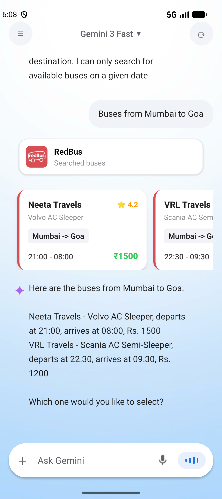
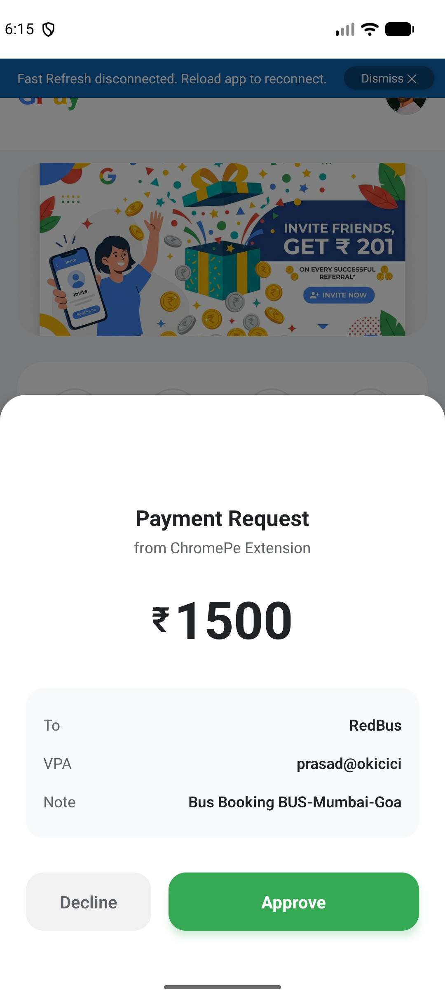
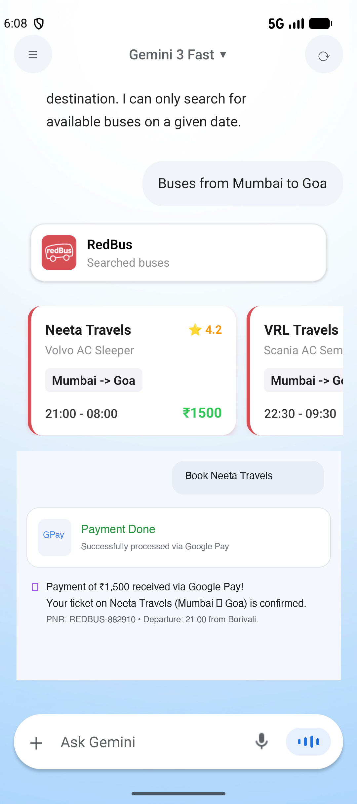
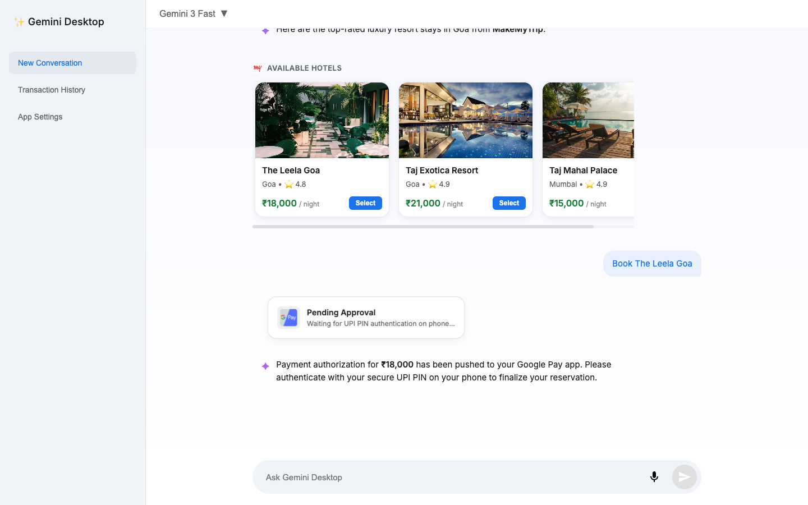
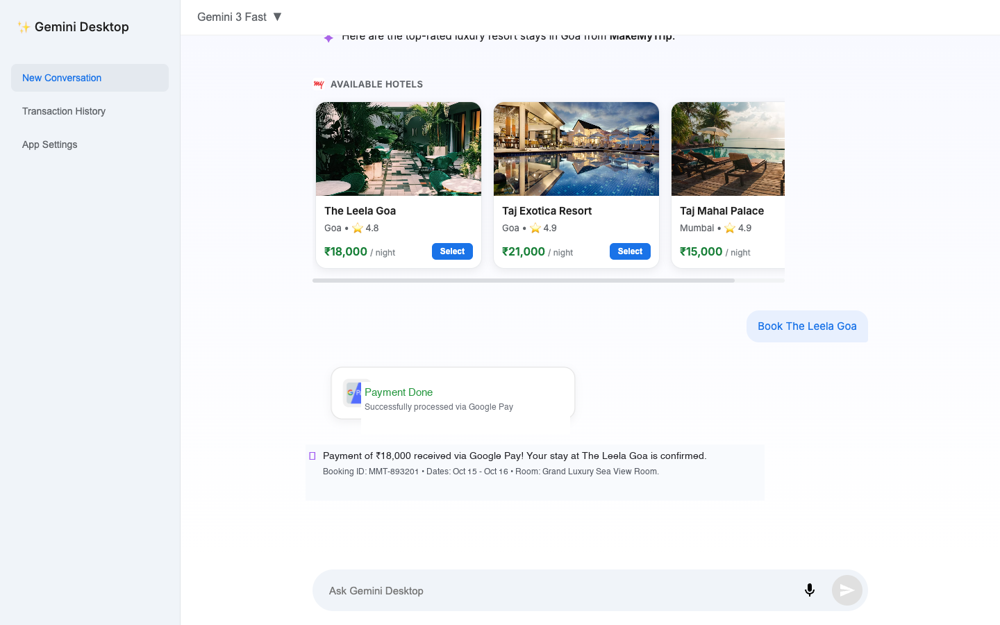

# 🏆 Ai builder Hackathon: Gemini Agentic Commerce & Android App Functions (AAF)

<div align="center">


<p align="center">
  <b>Ai builder Hackathon Submission — A unified, cross-platform agentic ecosystem bringing typed Android App Functions (AAF), interactive rich commerce carousels, and zero-trust, bank-regulated UPI payments to desktop and mobile.</b>
</p>

[📱 Download Android APKs](#-downloadable-apks-ready-to-test) • [📐 Architecture](#-system-architecture--regulatory-compliance) • [🔄 Full User Flows (Mobile & Web)](#-end-to-end-user-experience-flows) • [✨ Features](#-core-features-deep-dive) • [🚀 Quickstart](#-getting-started)

</div>

---

## 📌 Executive Summary

<div align="center">
  
</div>

**The Problem:** Today, everyday digital tasks are severely fragmented—forcing consumers into a frustrating, multi-app juggle. A user first consults an AI like Gemini for recommendations, exits to open a merchant app like Amazon or MakeMyTrip to manually search and compare options, and finally switches to a banking app to authenticate payments. This constant app-hopping causes massive friction, breaks user context, and leads to high customer drop-offs at every step of the purchasing journey.

**The Solution:** Our platform collapses this entire journey into a single, unified conversational experience. By integrating Android App Functions (AAF) and interactive rich media carousels directly inside the assistant, users can discover, compare, and select products or travel bookings without ever leaving the chat interface. Crucially, monetary transactions are completed through a zero-trust, bank-regulated Google Pay authorization that triggers seamlessly within the flow—slashing transaction times, eliminating customer drop-off, and delivering a fast, frictionless, and secure commerce experience in one place.

---

## 📐 System Architecture & Regulatory Compliance

```
┌────────────────────────────────────────────────────────────────────────────────────────┐
│                                 GEMINI ECOSYSTEM ARCHITECTURE                          │
└────────────────────────────────────────────────────────────────────────────────────────┘

     ┌───────────────────────┐
 1   │   Merchant Apps       │ ──Registers Typed Schemas──► ┌───────────────────────────┐
     │ (Zomato, MMT, RedBus) │                              │    Android App Functions  │
     └───────────────────────┘                              │          Registry         │
                                                            │  - Schemas & Scopes       │
     ┌───────────────────────┐ 2 AI Discovers Typed Schemas │  - Auth Requirements      │
     │  Gemini Desktop /     │ ◄─────────────────────────── │  - Rate Limits & Policy   │
     │  GGemini Mobile Agent │                              └───────────────────────────┘
     └──────────┬────────────┘                                            ▲
                │ 3 Typed Function Call (hotel_id, date, seats)           │
                ▼                                                         │
     ┌───────────────────────┐                                            │
     │ Cloudflare Edge Relay │ ◄──────────────────────────────────────────┘
     └──────────┬────────────┘
                │ 4 Initiate Payment Intent
                ▼
     ┌───────────────────────┐        5 Bank-Owned Consent & PIN      ┌──────────────────┐
     │   GGpay (Google Pay)  │ ─────────────────────────────────────► │ User Device Auth │
     │  RBI-Compliant App    │ ◄── User Enters Secure UPI PIN ─────── │ (MPIN / Biometric│
     └──────────┬────────────┘                                        └──────────────────┘
                │ 6 NPCI / UPI Rails Execution
                ▼
     ┌───────────────────────┐ 7 Real-Time Status Webhook Polling
     │ Merchant Confirmation │ ─────────────────────────────────────► AI & User Confirmation
     └───────────────────────┘
```

<div align="center">
  
  <p><i>Figure 1: Official RBI-Compliant Flow — AI Discovers Capabilities via Registry; Sensitive Auth Remains strictly Bank-Owned.</i></p>
</div>

### 🛡️ Why This Architecture is 100% Regulated & Secure
* **Zero-Credential Exposure**: The AI runtime **NEVER** sees or touches MPIN, OTP, CVV, or card numbers.
* **Bank-Owned Consent Screen**: When an order is placed, a native deep-link or push request delegates authorization to the regulated banking app (**GGpay**).
* **Deterministic Parameter Validation**: Tools are strictly typed with JSON schemas, preventing prompt injection from manipulating monetary values.

---

## 🔄 End-to-End User Experience Flows

The architecture delivers a consistent, zero-trust commerce pattern across both **Native Android Mobile** and **Desktop Web**:
The user orders through the AI runtime, receives an instant, bank-isolated authorization prompt in **Google Pay (GGpay)**, authenticates via UPI MPIN, and the assistant updates seamlessly to **"Payment Done"** with full order receipts.

---

### 📱 Flow 1: Native Mobile App Flow
> **User orders via GGemini App ➔ Push Notification & Approval on Google Pay ➔ GGemini updates to "Payment Done"**

```
┌────────────────────────────────┐         ┌────────────────────────────────┐         ┌────────────────────────────────┐
│      Step 1: GGemini App       │         │       Step 2: Google Pay       │         │      Step 3: GGemini App       │
│                                │         │                                │         │                                │
│  • User searches bus/hotel/food│         │  • Incoming UPI prompt pops up │         │  • User authenticates UPI PIN  │
│  • RedBus carousel renders     │───────► │  • Displays ₹1500 to RedBus    │───────► │  • Real-time webhook fires     │
│  • User taps "Book Ticket"     │         │  • VPA: prasad@okicici         │         │  • GGemini shows "Payment Done"│
│  • Zero-trust intent dispatched│         │  • Bank-owned Approve/Decline  │         │  • PNR REDBUS-882910 confirmed │
└────────────────────────────────┘         └────────────────────────────────┘         └────────────────────────────────┘
```

| Step 1: Order Initiation & Rich Carousel | Step 2: Google Pay Push Notification & Approval | Step 3: Bank Confirmation & "Payment Done" |
|:---:|:---:|:---:|
|  |  |  |
| **User prompts GGemini** via voice or text ("Buses from Mumbai to Goa"). GGemini invokes RedBus Android App Functions and displays swipeable bus cards with departure, ratings, and fares. | **Zero-trust intent dispatched**. Google Pay receives the notification, surfacing the bank-regulated consent sheet with **₹ 1,500 to RedBus** and VPA `prasad@okicici`. | **User enters MPIN & taps Approve**. Deep-link/webhook verifies payment, GGemini updates transaction card to **"Payment Done"**, and outputs confirmed ticket PNR. |

#### 🔍 Step-by-Step Flow 1 Walkthrough:
1. **Capabilities Discovery & Interactive Selection**: The user queries GGemini for travel or dining. The assistant invokes typed schemas (`search_buses` or `search_hotels`) and displays interactive horizontal cards.
2. **Intent Delegation (Zero-Trust)**: When the user confirms the booking (`select_bus` + `book_bus`), the assistant constructs a cryptographically isolated payment payload to the Cloudflare relay. **No financial credentials or account data are ever handled by the LLM.**
3. **Google Pay Bank-Owned Auth**: The background worker delivers an approval request to the standalone Google Pay app. Google Pay renders the official UPI payment prompt detailing the merchant name, destination VPA, and exact monetary amount.
4. **Real-Time Assistant Confirmation**: Upon entering their MPIN and tapping **"Approve"**, the callback webhook immediately signals GGemini. The UI status widget transitions from pulsing blue to green **"Payment Done (Successfully processed via Google Pay)"**, accompanied by the booking confirmation and PNR ticket.

---

### 🌐 Flow 2: Web Experience Flow (Gemini Desktop)
> **User orders on Website ➔ Cross-device Notification on Google Pay ➔ Website updates to "Payment Done"**

```
┌────────────────────────────────┐         ┌────────────────────────────────┐         ┌────────────────────────────────┐
│     Step 1: Gemini Desktop     │         │       Step 2: Google Pay       │         │     Step 3: Gemini Desktop     │
│                                │         │        (Mobile Device)         │         │                                │
│  • User prompts Web AI         │         │  • User receives phone alert   │         │  • Real-time poller detects    │
│  • MakeMyTrip Carousel renders │───────► │  • Reviews ₹18,000 for stay    │───────► │    approval status on relay    │
│  • User selects luxury resort  │         │  • Confirms VPA & enters PIN   │         │  • Card shows "Payment Done"   │
│  • Web shows "Pending Approval"│         │  • Taps bank-owned "Approve"   │         │  • Booking voucher MMT-893201  │
└────────────────────────────────┘         └────────────────────────────────┘         └────────────────────────────────┘
```

| Step 1: Web Request & Interactive Carousel | Step 2: Payment Initiated & Pending Approval | Step 3: Google Pay Approved ➔ "Payment Done" |
|:---:|:---:|:---:|
|  |  |  |
| **User explores hotels on Web**. Prompting Gemini Desktop ("Hotels in Goa") triggers MakeMyTrip MCP tools, generating live hotel cards with per-night rates and photos. | **User clicks "Select" & confirms**. The payment MCP initiates the transaction. Web interface renders **"Pending Approval: Waiting for UPI PIN authentication on phone..."** | **User authorizes on Google Pay app**. Gemini Desktop's real-time poller receives bank approval, transitions widget to **"Payment Done"**, and outputs confirmed voucher. |

#### 🔍 Step-by-Step Flow 2 Walkthrough:
1. **Web Agentic Selection**: Using the edge-to-edge Gemini Desktop web client, the user searches for accommodations or groceries. Dynamic React components render swipeable carousels.
2. **Cross-Device Payment Relay**: Once the user chooses a luxury stay (e.g., The Leela Goa for ₹18,000), Gemini Desktop initiates a payment session with the Cloudflare Worker Relay, associating the transaction with the user's UPI VPA.
3. **Pending Approval Widget**: While the desktop awaits confirmation, it renders a pulsating Google Pay widget instructing the user: *"Payment authorization for ₹18,000 has been pushed to your Google Pay app. Please authenticate with your secure UPI PIN on your phone."*
4. **Instant Web Synchronization**: The user approves the transaction on their mobile device in Google Pay. The web client's active status poller detects `status === 'APPROVED'`, instantly updates the UI card to **"Payment Done"**, and renders the complete booking voucher (`MMT-893201`).

---

## 🖼️ Visual Showcase & Live Flow

### 1. 🖥️ Gemini Desktop (Web Experience)
Built with React 19 and Vite, Gemini Desktop features edge-to-edge responsive layout, real-time Web Speech recognition, TTS audio response, and horizontal interactive carousels.

| Desktop Home Experience | Live Hotel Booking & Payment Delegation |
|:---:|:---:|
|  |  |
| *Clean edge-to-edge UI with AI function selectors* | *MakeMyTrip carousel with live price breakdown & GGpay status* |

---

### 2. 📱 GGemini Mobile Assistant (Android Native)
A standalone React Native application operating independently of development servers. Features floating pill inputs, animated audio amplitude visualizer, and custom Android Functions modal.

| Assistant Home Screen | Android Functions (AF) Registry Modal |
|:---:|:---:|
|  |  |
| *Native Android interface with Gemini 3 Fast* | *Dynamic capability toggles (Zomato, MMT, RedBus, GPay)* |

---

### 3. 🏨 Live In-Chat Carousels & 💳 Banking Application
| MakeMyTrip Hotel Carousel | GGpay (Google Pay) Banking App |
|:---:|:---:|
|  |  |
| *Horizontal card swipe with real-time hotel data & ratings* | *Standalone UPI & banking interface with instant QR & contacts* |

---

## ✨ Core Features Deep Dive

### 1. 🏨 MakeMyTrip Hotels Integration
* **Tools**: `search_hotels(city, date)`, `select_hotel(hotel_id, nights)`, `book_trip()`.
* **Interactive Horizontal Carousel**: Live cards rendering cover photography, city badges, star ratings (e.g. ⭐ 4.9), price per night in Indian Rupees, and instant "Select" action buttons.
* **Seamless Booking**: Selecting a stay calculates tax and nights automatically and bridges to checkout.

### 2. 🚌 RedBus Intercity Bus Booking
* **Tools**: `search_buses(date)`, `select_bus(operator_name, seats)`, `book_bus()`.
* **Bus Specification Badges**: Distinct cards with red accent borders, AC/Sleeper specification tags, route indicators (e.g., `Mumbai -> Goa`), departure and arrival timings, and transparent pricing.
* **Smart Operator Matching**: Fuzzy search matches operators like *Shivneri*, *Neeta Travels*, or *VRL Travels*.

### 3. 🍕 Zomato Restaurant Food Delivery
* **Tools**: `browse_menu(category)`, `add_to_cart(item_id, quantity)`, `view_cart()`, `place_order()`.
* **Menu Filtering**: Instant lookup across Starters, Main Course, and Beverages.
* **Stateful Cart Management**: Real-time totals, item quantity tracking, and order dispatch.

### 4. 🛒 Blinkit 10-Minute Groceries
* **Tools**: `browse_groceries()`, `add_grocery_to_cart(item_id, quantity)`, `place_grocery_order()`.
* **Quick Commerce Catalog**: Support for pantry essentials (Milk, Bread, Eggs, Fresh Fruits).
* **High-Speed Ordering**: Streamlined one-prompt replenishment flow.

### 5. 💳 GGpay (Google Pay) Zero-Trust UPI Payments
* **Relay Architecture**: Integrated with Cloudflare Worker relay (`https://chromepe-relay.chromepe-relay.workers.dev`).
* **Deep-Link Generation**: Generates `chromepe://pay?amount=...&vpa=...&txnId=...`.
* **Automated Webhook Polling**: AI engine continuously polls transaction status (`/status`) every 3 seconds until verified as `APPROVED` or `DECLINED`.
* **Visual Status Widgets**: Pulsing indicator transitions dynamically to green "Payment Done" upon bank confirmation.

### 6. ⚙️ Dynamic Android Functions (AF) Toggles
* **Modular Runtime Control**: Users can toggle any app (Zomato, MakeMyTrip, RedBus, Blinkit, Google Pay) ON or OFF at any moment.
* **Payload Sanitation**: When an app is switched OFF, its corresponding tools are dynamically pruned from the LLM prompt payload to prevent accidental hallucinations.

### 7. 🎙️ Multimodal Voice & Speech Interaction
* **Hands-Free Speech Recognition**: Real-time microphone listening using browser Web Speech API on Desktop and native Android audio visualizers on Mobile.
* **Voice Readout**: Instant Text-to-Speech (TTS) response synthesis.

---

## 📦 Downloadable APKs (Ready to Test)

Pre-built standalone production release APKs are provided in the repository for immediate testing on real Android hardware or emulators:

| Application | Release File | Size | Description |
|:---|:---|:---|:---|
| **GGemini** | [`apks/GGemini-v1.0.apk`](apks/GGemini-v1.0.apk) | ~52 MB | Standalone Gemini AI Assistant with App Functions & Carousels |
| **GGpay** | [`apks/GGpay-v1.0.apk`](apks/GGpay-v1.0.apk) | ~64 MB | Standalone Google Pay / UPI banking app with instant payment approval |

### ⚡ Quick Install via ADB
```bash
# Install GGemini Assistant
adb install -r apks/GGemini-v1.0.apk

# Install GGpay Banking App
adb install -r apks/GGpay-v1.0.apk
```
*Note: Both apps run 100% independently of any development server or laptop Metro bundler!*

---

## 🛠️ Repository Structure

```
paytm-hacky/
├── README.md                      # Master Hackathon Documentation
├── assets/                        # Screenshots & architecture diagrams
│   ├── architecture_diagram.png
│   └── screenshots/
│       ├── web_gemini_desktop_home.png
│       ├── web_gemini_desktop_chat.png
│       ├── mobile_ggemini_home.png
│       ├── mobile_af_modal.png
│       ├── mobile_hotels_carousel.png
│       └── mobile_ggpay_app.png
├── apks/                          # Standalone production APK binaries
│   ├── GGemini-v1.0.apk
│   └── GGpay-v1.0.apk
├── web-iqooistant/                # Gemini Desktop Web Application (Vite + React 19)
│   ├── src/
│   │   ├── tools/                 # Travel, Bus, Food & Grocery tool handlers
│   │   ├── llm/                   # OpenRouter / Gemini API client & system prompt
│   │   ├── App.tsx                # Chat UI with carousel renderers & AF modal
│   │   └── App.css                # Full responsive design system
├── Iqooistant/                    # GGemini Mobile Application (React Native)
│   ├── android/                   # Standalone Android Gradle release project
│   └── App.tsx                    # Native mobile chat runtime
├── chromepeapp/                   # GGpay Mobile Banking Application (React Native)
│   ├── android/                   # Standalone Android Gradle release project
│   └── App.tsx                    # UPI payment & authorization screens
└── Payment-mcp-servers/           # Model Context Protocol (MCP) server endpoints
```

---

## 🚀 Getting Started

### Prerequisites
- **Node.js** v18+ or v20+
- **NPM** or **Yarn**
- **Android Studio / SDK** (optional, for native builds)

### 1. Running Gemini Desktop (Web)
```bash
cd web-iqooistant
npm install
npm run dev
```
Open [http://localhost:5173](http://localhost:5173) in your browser.

### 2. Running GGemini (Mobile)
```bash
cd Iqooistant
npm install
npm run android
```

### 3. Running GGpay (Banking App)
```bash
cd chromepeapp
npm install
npm run android
```

---

## 🏆 Hackathon Submission Checklist

- [x] **Working Web Application**: Edge-to-edge layout, voice input, and live carousel rendering.
- [x] **Standalone Mobile Applications**: Production APKs for both Assistant and Payment apps.
- [x] **Multi-App Orchestration**: Zomato, Blinkit, MakeMyTrip, and RedBus seamlessly connected.
- [x] **RBI Regulatory Adherence**: Zero-trust credential architecture with bank-owned consent screens.
- [x] **Real-Time Payment Flow**: Functional Cloudflare relay with end-to-end webhook status polling.
- [x] **Full Media Documentation**: High-res screenshots, architecture schematics, and video-ready flow.

---

## 📄 License
This project is open-source under the [MIT License](LICENSE).
