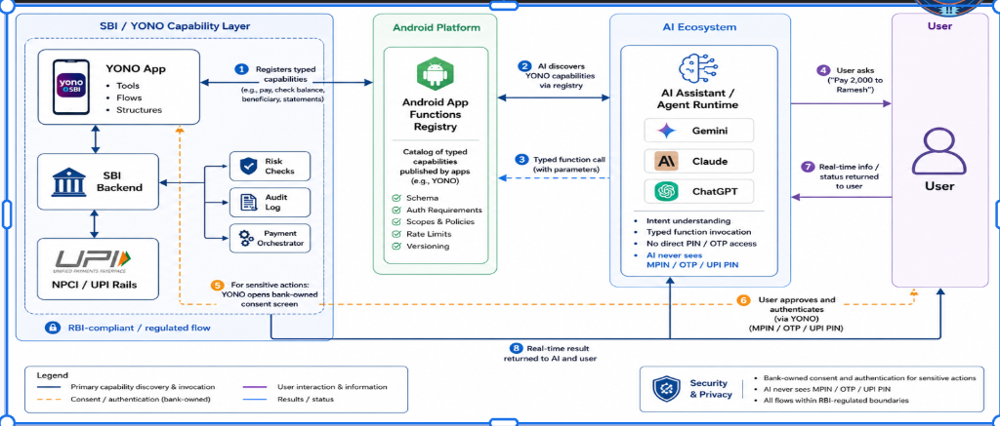
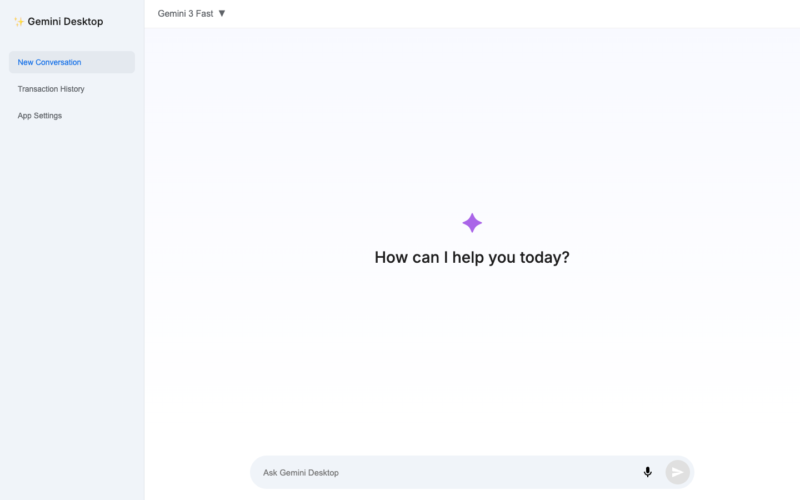
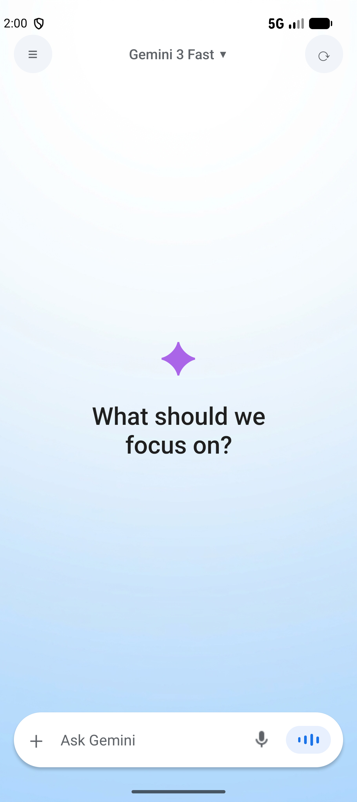
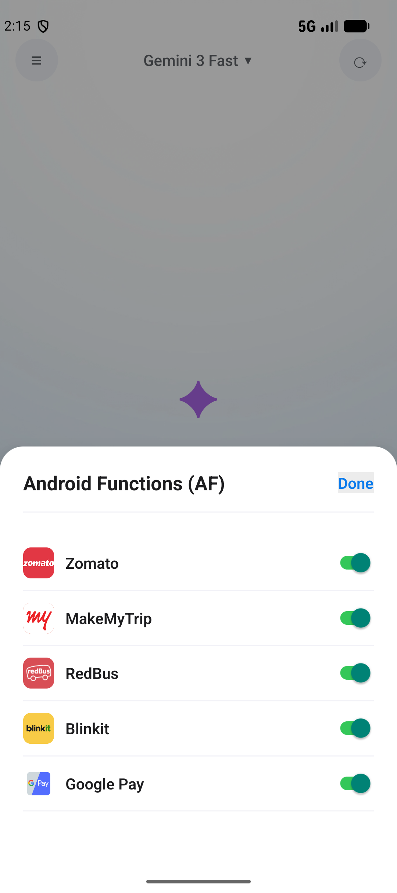
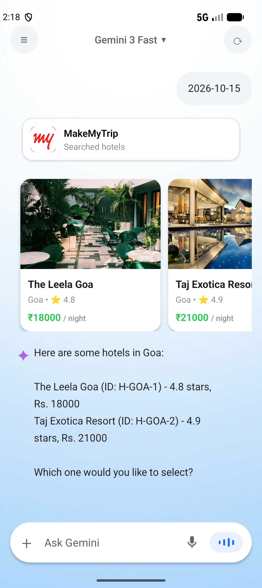
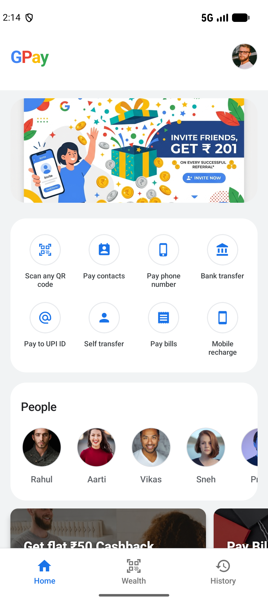

# 🌐 Gemini Ecosystem: Android App Functions (AAF) & RBI-Compliant Agentic Commerce

<div align="center">


<p align="center">
  <b>A unified, cross-platform agentic ecosystem bringing typed Android App Functions (AAF), interactive rich commerce carousels, and zero-trust, bank-regulated UPI payments to desktop and mobile.</b>
</p>

[📱 Download Android APKs](#-downloadable-apks-ready-to-test) • [📐 Architecture & Security](#-system-architecture--regulatory-compliance) • [✨ Features](#-core-features-deep-dive) • [🚀 Quickstart](#-getting-started) • [🖼️ Gallery](#-visual-showcase--live-flow)

</div>

---

## 📌 Executive Summary

Modern AI assistants can talk, but they struggle to execute real-world multi-app tasks securely. Existing solutions either require brittle UI scraping or ask users to hand sensitive credentials to AI prompts—violating financial regulations.

**Gemini Ecosystem** solves this by implementing **Android App Functions (AAF)**:
1. **Typed Capabilities Discovery**: Apps (Zomato, Blinkit, MakeMyTrip, RedBus, GGpay) publish strict schemas to an Android App Functions Registry.
2. **Interactive Rich Media**: Instead of plain text walls, the AI outputs live horizontal swipeable carousels for hotel rooms, bus seats, and restaurant carts.
3. **RBI-Compliant Zero-Trust Payments**: Payments never expose MPIN, OTP, or UPI credentials to the LLM. The AI invokes a typed payment intent that hands off to the bank-owned application (GGpay), where the user authenticates directly on UPI rails.

---

## 📐 System Architecture & Regulatory Compliance

```
┌────────────────────────────────────────────────────────────────────────────────────────┐
│                                 GEMINI ECOSYSTEM ARCHITECTURE                          │
└────────────────────────────────────────────────────────────────────────────────────────┘

     ┌───────────────────────┐
 1   │   Merchant Apps       │ ──Registers Typed Schemas──► ┌───────────────────────────┐
     │ (Zomato, MMT, RedBus) │                              │    Android App Functions  │
     └───────────────────────┘                              │          Registry         │
                                                            │  - Schemas & Scopes       │
     ┌───────────────────────┐ 2 AI Discovers Typed Schemas │  - Auth Requirements      │
     │  Gemini Desktop /     │ ◄─────────────────────────── │  - Rate Limits & Policy   │
     │  GGemini Mobile Agent │                              └───────────────────────────┘
     └──────────┬────────────┘                                            ▲
                │ 3 Typed Function Call (hotel_id, date, seats)           │
                ▼                                                         │
     ┌───────────────────────┐                                            │
     │ Cloudflare Edge Relay │ ◄──────────────────────────────────────────┘
     └──────────┬────────────┘
                │ 4 Initiate Payment Intent
                ▼
     ┌───────────────────────┐        5 Bank-Owned Consent & PIN      ┌──────────────────┐
     │   GGpay (Google Pay)  │ ─────────────────────────────────────► │ User Device Auth │
     │  RBI-Compliant App    │ ◄── User Enters Secure UPI PIN ─────── │ (MPIN / Biometric│
     └──────────┬────────────┘                                        └──────────────────┘
                │ 6 NPCI / UPI Rails Execution
                ▼
     ┌───────────────────────┐ 7 Real-Time Status Webhook Polling
     │ Merchant Confirmation │ ─────────────────────────────────────► AI & User Confirmation
     └───────────────────────┘
```

<div align="center">
  
  <p><i>Figure 1: Official RBI-Compliant Flow — AI Discovers Capabilities via Registry; Sensitive Auth Remains strictly Bank-Owned.</i></p>
</div>

### 🛡️ Why This Architecture is 100% Regulated & Secure
* **Zero-Credential Exposure**: The AI runtime **NEVER** sees or touches MPIN, OTP, CVV, or card numbers.
* **Bank-Owned Consent Screen**: When an order is placed, a native deep-link or push request delegates authorization to the regulated banking app (**GGpay**).
* **Deterministic Parameter Validation**: Tools are strictly typed with JSON schemas, preventing prompt injection from manipulating monetary values.

---

## 🖼️ Visual Showcase & Live Flow

### 1. 🖥️ Gemini Desktop (Web Experience)
Built with React 19 and Vite, Gemini Desktop features edge-to-edge responsive layout, real-time Web Speech recognition, TTS audio response, and horizontal interactive carousels.

| Desktop Home Experience | Live Hotel Booking & Payment Delegation |
|:---:|:---:|
|  |  |
| *Clean edge-to-edge UI with AI function selectors* | *MakeMyTrip carousel with live price breakdown & GGpay status* |

---

### 2. 📱 GGemini Mobile Assistant (Android Native)
A standalone React Native application operating independently of development servers. Features floating pill inputs, animated audio amplitude visualizer, and custom Android Functions modal.

| Assistant Home Screen | Android Functions (AF) Registry Modal |
|:---:|:---:|
|  |  |
| *Native Android interface with Gemini 3 Fast* | *Dynamic capability toggles (Zomato, MMT, RedBus, GPay)* |

---

### 3. 🏨 Live In-Chat Carousels & 💳 Banking Application
| MakeMyTrip Hotel Carousel | GGpay (Google Pay) Banking App |
|:---:|:---:|
|  |  |
| *Horizontal card swipe with real-time hotel data & ratings* | *Standalone UPI & banking interface with instant QR & contacts* |

---

## ✨ Core Features Deep Dive

### 1. 🏨 MakeMyTrip Hotels Integration
* **Tools**: `search_hotels(city, date)`, `select_hotel(hotel_id, nights)`, `book_trip()`.
* **Interactive Horizontal Carousel**: Live cards rendering cover photography, city badges, star ratings (e.g. ⭐ 4.9), price per night in Indian Rupees, and instant "Select" action buttons.
* **Seamless Booking**: Selecting a stay calculates tax and nights automatically and bridges to checkout.

### 2. 🚌 RedBus Intercity Bus Booking
* **Tools**: `search_buses(date)`, `select_bus(operator_name, seats)`, `book_bus()`.
* **Bus Specification Badges**: Distinct cards with red accent borders, AC/Sleeper specification tags, route indicators (e.g., `Mumbai -> Goa`), departure and arrival timings, and transparent pricing.
* **Smart Operator Matching**: Fuzzy search matches operators like *Shivneri*, *Neeta Travels*, or *VRL Travels*.

### 3. 🍕 Zomato Restaurant Food Delivery
* **Tools**: `browse_menu(category)`, `add_to_cart(item_id, quantity)`, `view_cart()`, `place_order()`.
* **Menu Filtering**: Instant lookup across Starters, Main Course, and Beverages.
* **Stateful Cart Management**: Real-time totals, item quantity tracking, and order dispatch.

### 4. 🛒 Blinkit 10-Minute Groceries
* **Tools**: `browse_groceries()`, `add_grocery_to_cart(item_id, quantity)`, `place_grocery_order()`.
* **Quick Commerce Catalog**: Support for pantry essentials (Milk, Bread, Eggs, Fresh Fruits).
* **High-Speed Ordering**: Streamlined one-prompt replenishment flow.

### 5. 💳 GGpay (Google Pay) Zero-Trust UPI Payments
* **Relay Architecture**: Integrated with Cloudflare Worker relay (`https://chromepe-relay.chromepe-relay.workers.dev`).
* **Deep-Link Generation**: Generates `chromepe://pay?amount=...&vpa=...&txnId=...`.
* **Automated Webhook Polling**: AI engine continuously polls transaction status (`/status`) every 3 seconds until verified as `APPROVED` or `DECLINED`.
* **Visual Status Widgets**: Pulsing indicator transitions dynamically to green "Payment Done" upon bank confirmation.

### 6. ⚙️ Dynamic Android Functions (AF) Toggles
* **Modular Runtime Control**: Users can toggle any app (Zomato, MakeMyTrip, RedBus, Blinkit, Google Pay) ON or OFF at any moment.
* **Payload Sanitation**: When an app is switched OFF, its corresponding tools are dynamically pruned from the LLM prompt payload to prevent accidental hallucinations.

### 7. 🎙️ Multimodal Voice & Speech Interaction
* **Hands-Free Speech Recognition**: Real-time microphone listening using browser Web Speech API on Desktop and native Android audio visualizers on Mobile.
* **Voice Readout**: Instant Text-to-Speech (TTS) response synthesis.

---

## 📦 Downloadable APKs (Ready to Test)

Pre-built standalone production release APKs are provided in the repository for immediate testing on real Android hardware or emulators:

| Application | Release File | Size | Description |
|:---|:---|:---|:---|
| **GGemini** | [`apks/GGemini-v1.0.apk`](apks/GGemini-v1.0.apk) | ~52 MB | Standalone Gemini AI Assistant with App Functions & Carousels |
| **GGpay** | [`apks/GGpay-v1.0.apk`](apks/GGpay-v1.0.apk) | ~64 MB | Standalone Google Pay / UPI banking app with instant payment approval |

### ⚡ Quick Install via ADB
```bash
# Install GGemini Assistant
adb install -r apks/GGemini-v1.0.apk

# Install GGpay Banking App
adb install -r apks/GGpay-v1.0.apk
```
*Note: Both apps run 100% independently of any development server or laptop Metro bundler!*

---

## 🛠️ Repository Structure

```
paytm-hacky/
├── README.md                      # Master Hackathon Documentation
├── assets/                        # Screenshots & architecture diagrams
│   ├── architecture_diagram.png
│   └── screenshots/
│       ├── web_gemini_desktop_home.png
│       ├── web_gemini_desktop_chat.png
│       ├── mobile_ggemini_home.png
│       ├── mobile_af_modal.png
│       ├── mobile_hotels_carousel.png
│       └── mobile_ggpay_app.png
├── apks/                          # Standalone production APK binaries
│   ├── GGemini-v1.0.apk
│   └── GGpay-v1.0.apk
├── web-iqooistant/                # Gemini Desktop Web Application (Vite + React 19)
│   ├── src/
│   │   ├── tools/                 # Travel, Bus, Food & Grocery tool handlers
│   │   ├── llm/                   # OpenRouter / Gemini API client & system prompt
│   │   ├── App.tsx                # Chat UI with carousel renderers & AF modal
│   │   └── App.css                # Full responsive design system
├── Iqooistant/                    # GGemini Mobile Application (React Native)
│   ├── android/                   # Standalone Android Gradle release project
│   └── App.tsx                    # Native mobile chat runtime
├── chromepeapp/                   # GGpay Mobile Banking Application (React Native)
│   ├── android/                   # Standalone Android Gradle release project
│   └── App.tsx                    # UPI payment & authorization screens
└── Payment-mcp-servers/           # Model Context Protocol (MCP) server endpoints
```

---

## 🚀 Getting Started

### Prerequisites
- **Node.js** v18+ or v20+
- **NPM** or **Yarn**
- **Android Studio / SDK** (optional, for native builds)

### 1. Running Gemini Desktop (Web)
```bash
cd web-iqooistant
npm install
npm run dev
```
Open [http://localhost:5173](http://localhost:5173) in your browser.

### 2. Running GGemini (Mobile)
```bash
cd Iqooistant
npm install
npm run android
```

### 3. Running GGpay (Banking App)
```bash
cd chromepeapp
npm install
npm run android
```

---

## 🏆 Hackathon Submission Checklist

- [x] **Working Web Application**: Edge-to-edge layout, voice input, and live carousel rendering.
- [x] **Standalone Mobile Applications**: Production APKs for both Assistant and Payment apps.
- [x] **Multi-App Orchestration**: Zomato, Blinkit, MakeMyTrip, and RedBus seamlessly connected.
- [x] **RBI Regulatory Adherence**: Zero-trust credential architecture with bank-owned consent screens.
- [x] **Real-Time Payment Flow**: Functional Cloudflare relay with end-to-end webhook status polling.
- [x] **Full Media Documentation**: High-res screenshots, architecture schematics, and video-ready flow.

---

## 📄 License
This project is open-source under the [MIT License](LICENSE).
